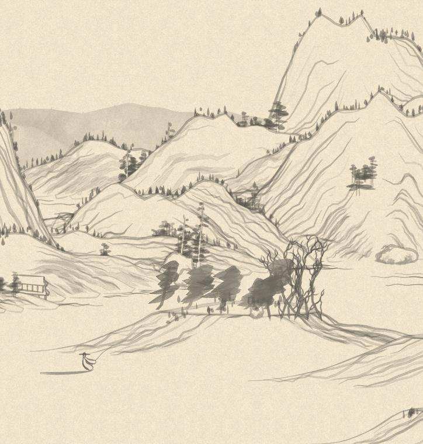

# Shan Shui for Wallpaper Engine

A Wallpaper Engine (web type) port of [LingDong-/shan-shui-inf](https://github.com/LingDong-/shan-shui-inf).
It's a procedurally generated, infinitely scrolling Chinese landscape.
The generator is the original code, extracted unchanged except for its output format.

## Install

1. Download `shanshui-wallpaper.zip` from the [latest release](https://github.com/mantertius/shanshui-wallpaper/releases/latest) and extract it.
2. In Wallpaper Engine, go to **Open Wallpaper** → **Open from File** and choose the extracted `index.html`.
   Alternatively, extract the zip into `wallpaper_engine/projects/myprojects/shanshui/`, and it shows up in your library.
3. Properties: **Seed** (empty = new landscape each start), **Scroll speed** (px/s), **Pixel snap**.
   The FPS limit set in Wallpaper Engine's general settings is respected.

Outside Wallpaper Engine: `node tools/serve.mjs` and open `http://localhost:8123/?seed=abc&speed=40`.

## Why it's fast

The original page rebuilds the whole SVG through `innerHTML` on every scroll step.
It also keeps every chunk it ever generated, so memory grows without bound.
This port changes the pipeline, not the art:

- **Generation and rasterization run in a Web Worker.** A chunk takes 90 to 450 ms to generate; that never touches the main thread.
  The worker is created from a Blob, so it works under `file://`.
  If workers or `OffscreenCanvas` are unavailable, the same engine runs on the main thread.
- **Each 512 px tile is painted exactly once** with Canvas 2D, in the original depth order.
  Polygons are culled by bounding box, and the result is multiply-blended onto the paper, as the original `mix-blend-mode` did.
  The finished `ImageBitmap` is transferred zero-copy to the page.
- **A tile is painted only when no future chunk can reach it.** Chunk geometry spills up to ~1100 world units left of its planner window (measured by `tools/probe.cjs`), and the engine keeps a 1600-unit lead.
- **Per frame the main thread writes one CSS transform.** The single display canvas is repainted only when the scroll crosses a whole device pixel.
  Sub-pixel motion is a compositor translate of that one layer, so tiles never show seams.
- **Memory is flat.** Chunks behind the next tile and the planner's occupancy grid are pruned; token strings are dropped after compiling to `Float32Array`s.
  `tools/soak.cjs` rendered 500 tiles at ~45 MB of steady heap.
- It pauses on `setPaused` / hidden, and stops requesting frames entirely at speed 0.

Measured in Chromium: 60 fps (p99 frame 16.9 ms), no long tasks, 3 MB main-thread heap.

## Files

| File | Role |
|---|---|
| `gen-core.js` | Generated from the upstream `index.html` by `node tools/build.mjs [path]`. Don't edit by hand. |
| `engine.js` | Worker-side tile engine (compile, cull, rasterize, prune). |
| `main.js` | Display, scrolling, Wallpaper Engine property listener. |
| `tools/` | `build.mjs` (extract generator), `probe.cjs` (generation cost / spill), `soak.cjs` (memory soak), `serve.mjs` (preview). |

Debug switch: `?noworker=1` forces the main-thread fallback.

## License

The port is MIT (`LICENSE`). The original {Shan, Shui}* is MIT, (c) 2018 Lingdong Huang, and its license is kept in `LICENSE-shan-shui-inf`.
